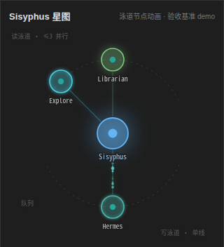

<!-- deepseek-harness-meta
{
  "name": "MyGO 编排器",
  "version": "0.6.0",
  "tags": ["preset", "模式预设"],
  "description": "把每一步路由到最合适模型的智能体编排器"
}
-->

# MyGO!!!!! 编排调度 | DSH

> 多智能体编排预设：主编调度 + 内置工种名册 + 报告落板。

dsh-my-go 是构建在 [DeepSeek Harness](https://github.com/deepseek-ai/deepseek-harness) (DSH) 之上的**智能体编排系统**（个人维护项目）。

它以星型嵌套 + 双泳道池化编排把 DSH 主会话（Sisyphus）与 8 个专业子智能体组织起来：Sisyphus 负责调度、审查与驳回，子智能体负责执行与汇报。参考了 [oh-my-opencode](https://github.com/code-yeongyu/oh-my-opencode)（前身 oh-my-openagent） 的编排设计，针对 DSH 进行了优化调整。

## 一眼看懂

给 DSH 主会话装上**多智能体编排大脑**：主编 Sisyphus 负责调度与质检，按任务难度把每一步路由到不同价位的内置工种模型，子代的报告落进报告板、不占主编上下文。



_上图为面板星图的**设计基准旧稿**（`docs/design/graph-running.png`）。面板实现已支持写泳道多槽（`writePoolSize` 容量驱动，见「特性 → 泳道双池」），但**图示仍是旧版单写槽设计稿**——重出基准图另行报备。_

- **星型拓扑，泳道可观测**：子代互不直连，都经主编中转。
- **按工种分模型，按量付费**：快活便宜、重活强模型。
- **报告落板**：子代全文进板，不占主编上下文。
- **泳道双池，双面并行**：写平面按 `writePoolSize` 并行（装机 3）、读平面按 `readPoolSize` 并行（装机 3），双车道各 3、峰值 6。
- **配置全在 WebUI**：模型/档位/备选链/单价。

## 特性

### 编排拓扑

- **星型嵌套 + 双泳道池化**：子智能体（叶子）互不通信，全部经主编 Sisyphus 中转；同一编排会话内的并发受泳道容量约束（装机双车道各 3、峰值 6 并行），便于审查与观测。
- **步骤级调度 + 质检**：Prometheus 只交素材（现状拆解 / 候选方向 / 风险清单），决断留在主编；结论不达标驳回重做，被驳回的子代保留上下文继续。
- **11 具编排 / 通信 / 报告 / 接力链工具**：`go_work` / `continue` / `need_help` / `relay` / `report_submit` 等。
- 拓扑与不变量见 [docs/ARCHITECTURE.md](docs/ARCHITECTURE.md) §1、§2.1。

### 8 工种名册

- **8 个内置工种**（`hermes` / `explore` / `librarian` / `looker` / `hephaestus` / `prometheus` / `oracle` / `apelles`）＋可在 `roles` 自定义角色；**按工种绑模型**（快活配便宜、重活配强模型），默认不绑、继承环境路由。
- 内置角色（除 Sisyphus）可在配置卡覆盖 persona；角色卡可导出 / 导入全字段 JSON；面板底部常驻花名册。
- 详见 [docs/ARCHITECTURE.md](docs/ARCHITECTURE.md) §2.3。

### 泳道双池

- **写平面并行池（`writePoolSize`）**：写平面（hermes / hephaestus / prometheus / oracle / looker 与自定义角色）按池并行，默认 1（=关闭=写平面串行）、钳 [1,3]、挂载期读一次不可热更。
- **读平面并行池（`readPoolSize`）**：读平面（explore / librarian）按池并行，默认 1、钳 [1,3]、挂载期读一次不可热更。
- **双车道各 3、峰值 6 并行**：两池各自独立计数，lane 内 FIFO；读池满不挡写任务、写池满不挡读任务。**两池皆 1 才退化为全局单线**（与旧行为逐字节等价）。并发投放写任务前须确认写集不相交且无数据依赖。
- 详见 [docs/ARCHITECTURE.md](docs/ARCHITECTURE.md) §2.8。

### 接力链

- **接力链（`relayChains`，默认关）**：总闸开时主编可声明一串按序执行的子代理跳（`chain_start` / `chain_resolve`）；上一跳产出直投下一跳数据面，全程不经过主编上下文。
- 挂起的链永不超时放行，每次回合的状态行与快照都带链进度。
- 状态机语义见 [docs/ARCHITECTURE.md](docs/ARCHITECTURE.md) §2.9 与 [docs/plans/relay-chain-semantics.md](docs/plans/relay-chain-semantics.md)。

### 报告板

- **报告外部化（`reportExternalization`）**：子代报告全文经 `report_submit` 与完工收尾双通道落板，主编用 `report_fetch` 按行切片取回，不把全文灌进上下文。
- **错误语义刻意不对称**：落板写失败抛错（board 是业务数据，绝不静默吞），读取缺席返回空。
- 契约与切片规则见 [docs/ARCHITECTURE.md](docs/ARCHITECTURE.md) §2.7。

### 配置面

- **WebUI 配置卡（唯一入口）**：每个工种的模型 / 思考档位 / 备选链、心跳与单价参数，都在 **DSH Web → 插件 → dsh-my-go** 里改。
- **未保存与并发写防线**：草稿改动即置「未保存」，保存条挂 `r<版本>` 栅栏；宿主侧被外部改动时提示漂移并可丢弃重读。
- 契约见 [docs/ARCHITECTURE.md](docs/ARCHITECTURE.md) §2.4、§2.11。

### 用量统计

- **四桶单价自填**（USD / 1M tokens，按 `{provider}/{model}`）；面板按实况实时算成本，缺桶显示「—」不补 0。
- 唯一规格源见 [docs/usage-stats-design.md](docs/usage-stats-design.md)；机制见 [docs/ARCHITECTURE.md](docs/ARCHITECTURE.md) §2.10。

### 面板

- **树状图浮层**（侧栏 🧭 按钮）：current / queue / help / history 与花名册常驻区；快照轮询带在飞请求门与失败退避（600 → 1500 → 3000ms）。
- 面板适配见 [docs/ARCHITECTURE.md](docs/ARCHITECTURE.md) §3。

### 防旁路

- **拓扑防线**：DSH 原生邻接消息三件套（`send_message` / `list_agents` / `interrupt_agent`）对主编与子代硬 deny；`subagent` / `subagent_fork` / `workflow` / `ralph` 仅在主编顶层保留。
- **工具继承**：各工种继承宿主工具权限；旧 `toolFilter` 配置可读取但明确忽略。防递归与邻接通信拓扑约束独立保留。

_真正实现 "按量付费"_
## 产品术语

- **主编（Sisyphus）**：编排会话的顶层角色——派工、验收与裁决都在它这一层；模型随对话框所选，`roles.sisyphus` 恒为名册顶级键。
- **工种**：子代理的角色类型（`hermes` / `explore` / `librarian` / `looker` / `hephaestus` / `prometheus` / `oracle` / `apelles`），决定人设、模型绑定与工具面；聚合面上也叫「内置工种」。
- **子代理**：主编按需派生的一次任务执行单元；它的 `subagent/end` 是归因、落账与队列推进的驱动事件。
- **泳道（lane）**：并发槽位的分组——写平面（其余工种）按 `writePoolSize` 并发、读平面（`explore` / `librarian`）按 `readPoolSize` 并发，两者皆默认 1、钳 [1,3]、挂载期读一次。
- **退化语义**：仅当两池皆 1（`readPoolSize=1` 且 `writePoolSize=1`）才退化为全局单线，与旧行为逐字节等价。
- **花名册（roster）**：角色名册的单一真源（`preset/shared/roles.mjs` 的 `rosterEntries`）；面板常驻区与系统提示简报共用同一份投影。
- **拍距**：主编心跳的唤醒间隔（`keepAlive.orchestratorIntervalMs`，出厂 250 秒 = 5 分钟缓存 TTL × 5/6）。
- **前瞻窗口 H**：`(输入价 ÷ 缓存命中价 − 1) × 拍距`——子代理剩余等待超过 H 时它已经不值得再等一拍（缓存届时已凉），低于 H 则继续。
- **报告板（board）**：子代报告的落板存储；`report_submit` 写入、`report_fetch` 按行切片取回，`deviation` / `unverified` 两字段由落板渲成两节拼在报告正文之后。

## 环境要求

### 理论最低要求

- DeepSeek Harness `0.1.7-alpha.1`+（与 package.json peer `>=0.1.7-alpha.1 <0.3.0` 一致；基于 `agent/request` waterfall、continuable subagent API 与 preset 声明行范式。上界 `<0.3.0` 的依据是**实机验证线**：宿主 `0.2.0-rc.1` 上 `followup` 唤醒语义（心跳投递原语）已实机核过，故旧口径的 `<0.2.0` 不再成立）
- Node.js 22.15+（`node:zlib` 的 zstd 压缩接口实需 22.15+/23.8+，与 package.json `engines` 一致）
- 一个可用的 LLM provider
- Windows / macOS / Linux（DSH 均支持）

### 开发时的环境

- **Linux**（本机 `uname -srm` = `Linux 7.0.0-34-generic x86_64`）；**曾在 Windows 11 开发，现已迁到 Linux**——CI 用 `ubuntu-latest` + `windows-latest` 双矩阵兜底（`.github/workflows/ci.yml`）。
- **Node.js**：`.nvmrc` 声明 `22.15`（CI 走 `node-version-file: .nvmrc`），`package.json` `engines` 同源 `>=22.15`；本机实测 `node -v` = `v24.21.0`（高于声明值，可用）。
- 宿主包版本以本仓 `devDependencies` 为准（`@deepseek-ai/dsh-agent` / `dsh-llm` / `dsh-subagent` 均为 `^0.1.7-alpha.1`，与 peer floor 同线）。
- 依赖安装走 **npm + 已提交的 `package-lock.json`**（CI 用 `npm ci`）；构建与测试直调 node，不需要 bun。
- `test/compat-alpha4.test.mjs` 的**宿主契约哨兵**是本仓唯一拿真宿主 subagent 运行时对账的闸门（DSH 把 `followup` / `reportFrom` 改名或删除时，所有 mock 测试都照样绿）——`npm test` 的 `# skipped 0` 就是它在位的证据。

## 快速开始

### 安装（从 git clone）

**前置要求**

| 项 | 要求 | 怎么确认 / 怎么补 |
|---|---|---|
| Node.js | `>=22.15` | `node -v`（低于则先升级 Node，别硬装） |
| dsh | 已全局安装 | `dsh --version`（装法见 DeepSeek Harness 官方文档） |
| clone 依赖 | 已在 clone 目录跑过 `npm install` | `ls <clone>/node_modules/@deepseek-ai` 有内容；缺了会在 `dsh web` 报 `dsh-my-go: failed to import`（见下方警告） |
| pnpm | 在 PATH 上 | `pnpm -v`；报「不是内部或外部命令」/`command not found` 就 `npm i -g pnpm` 补装 |

> `dsh plugin` 本质是 **pnpm 转发器**：它在 profile 目录里跑 `pnpm add <你给的路径>`，
> 成功后再把 `dsh.profile.bundles` 对齐到实际装上的依赖。所以 pnpm 缺席时
> `dsh plugin` 直接失败（退出码 127），不是 dsh 的 bug。

> ⚠️ **clone 目录必须装过依赖**。本插件以 **`link:`（链接）** 形式装进 profile：profile 里的
> `node_modules/dsh-my-go` 只是指回 clone 的链接，插件加载时按 **clone 的真实路径**解析自己的依赖，
> 所以依赖要落在 clone 里（就是上面第 2 步的 `npm install`）。缺了时 `dsh web` 会打印
> `1 entry did not activate` + `dsh-my-go: failed to import`
> （`ERR_MODULE_NOT_FOUND: @deepseek-ai/schemastery`）。补法是补 **clone** 那一侧：
> `cd <你的 clone 路径> && npm install`，然后重启 `dsh web`——**在 profile 目录补装同名包不解决**
> （实测：插件不按 profile 的 `node_modules` 解析）。

**安装步骤**

```bash
# 1) clone 到【永久稳定路径】——见下方红字警告，这路径以后不能挪、不能删
git clone --depth 1 https://github.com/Tisitan/dsh-my-go.git "<your-dsh-plugins>/dsh-my-go"

# 2) 在 clone 目录装一次依赖——插件按 clone 的真实路径解析依赖，缺了会导入失败
cd "<your-dsh-plugins>/dsh-my-go" && npm install

# 3) 装进 web profile（路径写绝对路径最稳；相对路径 dsh 会按你当前目录解析）
dsh plugin --profile web add "<your-dsh-plugins>/dsh-my-go"

# 4) 重启 Web GUI
dsh web
```

**验证装对了**（第 4 步之前先做，三条全中才算装好）

```powershell
# Windows PowerShell（用 ConvertFrom-Json：把反斜杠路径塞进 `node -p "require('...')"`
# 会被 JS 当转义吃掉，别那么写。也别用 $profile 这个名字——它是 PowerShell 自动变量）
$pkg = "$env:USERPROFILE\.dsh\profiles\web\package.json"
(Get-Content $pkg -Raw | ConvertFrom-Json).dependencies.'dsh-my-go'                     # 期望 link:<你的 clone 路径>
(Get-Content $pkg -Raw | ConvertFrom-Json).dsh.profile.bundles -contains 'dsh-my-go'    # 期望 True
Get-Item "$env:USERPROFILE\.dsh\profiles\web\node_modules\dsh-my-go" |
  Select-Object Name, LinkType, Target                                                   # 期望 LinkType = Junction
```

```bash
# POSIX（macOS / Linux）
profile="$HOME/.dsh/profiles/web"
node -p "require('$profile/package.json').dependencies['dsh-my-go']"           # link:.../dsh-my-go
node -p "require('$profile/package.json').dsh.profile.bundles.includes('dsh-my-go')"  # true
ls -l "$profile/node_modules/dsh-my-go"                                        # 指向 clone 路径的 symlink
```

三项分别是：profile 的 `package.json` 里出现 **`link:` 依赖**、`dsh.profile.bundles`
数组里**登记了 `dsh-my-go`**、`node_modules/dsh-my-go` 是一枚**指向 clone 目录的
junction/symlink**（不是拷贝）。

**首启会发生什么**：bundle 层自动应用插件自带的两枚 patch（无需手写 insert）——
`cordis.patch.yml` 挂 host 插件（`lib/index.js`：settings 配置面 + 面板 RPC），
`preset/agent.patch.yml` 声明「MyGO!!!!! 模式」预设行（声明行范式）——该预设即本仓的
产品形态：主编（Sisyphus）调度 + 内置工种名册 + 报告落板，装上即用；预设与
人设就地在包内生效——没有安装拷贝，也没有同步日志（安装同步机制已整体退役）。

之后新建会话的预设选择器里会出现 **「MyGO!!!!! 模式」**——编排十一具工具 + 模型绑定
由 preset 半 broker（经包说明符 `dsh-my-go/preset/tools/broker.mjs` 挂载）在该会话内
提供，树状图面板数据经快照桥实时透出。选择器里没有该模式，说明预设声明没生效
（多半是第 2 步的路径写错了）。

> 🔴 **clone 路径必须永久稳定**。`dsh plugin ... add <本地目录>` 装的是 **junction
> （链接）而不是拷贝**：profile 的 `node_modules/dsh-my-go` 永远指回你 clone 的那个
> 目录。把那个目录**移动 / 改名 / 删除**，下次 `dsh web` 就直接启动失败（模块解析
> 不到）。想换地方：先 `dsh plugin --profile web remove dsh-my-go`，挪完再 add 新路径。

### 升级

```bash
cd "<your-dsh-plugins>/dsh-my-go"   # 你的 clone 目录
git pull
dsh web                          # 重启即生效
```

不需要重装、不需要手动拷 preset：没有安装拷贝——包内 `preset/` 与 `prompts/` 就地
生效，家目录下不再有 preset 副本，`git pull` 到新内容后重启 `dsh web` 即用上最新
预设，无需任何重同步动作。

> **dist/client.js 与 release commit**：Web UI 加载的客户端产物
> `dist/client.js` **随 release commit 入库**（见「目录结构」与
> [docs/FORK-GUIDE.md](docs/FORK-GUIDE.md)「发布流程」，`git pull` 到 release commit
> 即自带，无需构建）。但 depth-1 clone + `git pull` 若跟进的不是 release commit
> （例如跟了开发分支的中间态），该文件可能缺失或过期——此时在 clone 目录自行
> `npm run build` 后再重启 `dsh web`。

### 卸载

```bash
dsh plugin --profile web remove dsh-my-go
dsh web
```

卸载只摘 profile 的依赖与 bundle 登记；已 clone 的目录还在，需要的话自行删除
（preset 就地生效，没有同步副本可清）。

### 平台差异小注

| 项 | Windows | macOS / Linux |
|---|---|---|
| profile / home 路径 | `%USERPROFILE%\.dsh\profiles\web` | `~/.dsh/profiles/web` |
| 链接形态 | **junction**（`mklink /J`，普通权限即可创建） | **symlink**（`ln -s`，无需特权） |
| 命令差异 | `dsh plugin --profile web add "<your-dsh-plugins>/dsh-my-go"` 写法与 POSIX 一致，路径分隔符 `/` `\` 都收 | 同左 |

行为完全一致，只有路径与链接类型两种叫法之差——上面「junction 不是拷贝、路径必须
永久稳定」这条在两边同样成立。

### 最小示例

新开一个 DSH 会话，预设选择 **MyGO!!!!! 模式**
然后对 Sisyphus 说：

> 告诉我这个项目是干啥的。

### 运行

```bash
dsh web   # 启动 Web GUI，新会话选择 MyGO!!!!! 模式
```

## 架构

```
用户 ──► Sisyphus（调度+质检）──► Hermes / Explore / Librarian / Looker
            │                        Hephaestus / Prometheus / Oracle
            └── 泳道阻塞队列 ◄── 所有子智能体结论回流
```

- 子智能体 = DSH **continuable subagent**，持久化独立 Session，支持后续邻接投递
  （continue / forward 经投递适配层：queued 档走真 FIFO 队列；**若该 runtime 给不出
  排队通路，queued 就地塌档为 steer 并留痕 warn，返回体 `mode` 如实回报，绝不静默
  降级**）。
- 模型绑定 = 创建时 `agentOptions` + `agent/request` waterfall 覆盖
  `reasoningEffort`（**跟随 DSH 模型目录**：只设置该模型实际支持的思考档位；
  模型无思考选项或档位不支持时不设置，走模型默认）。
- 泳道阻塞 = broker 编排状态机按编排会话分桶（各会话各持一份 当前运行 / 队列 /
  求助 / 历史）；读写两车道各自独立计数（`readPoolSize` / `writePoolSize`），
  两池皆 1 才退化为全局单线（见「特性 → 泳道双池」）。
- 面板通道 = host 半自行注册 `/dsh-my-go` 前缀路由，单通道 + 端点分发（快照 /
  工具清单 / 内置人设 / 用量四枚），统一信封 `{ok:true,value}` /
  `{ok:false,error:{code,message,details}}`；宿主 web 服务缺席即留痕跳过注册
  （headless / CLI 形态零影响）。设置读写与模型目录都走宿主官方信道。
- 详细设计见 [docs/ARCHITECTURE.md](docs/ARCHITECTURE.md)。
- 开发怎么起沙盒、验收判据与踩过的坑见 [docs/DEV-SANDBOX.md](docs/DEV-SANDBOX.md)。

## 配置

host 半（lib）用一枚配置 schema 声明自己的配置面：宿主据此生成官方插件页表单，
并以插件行 config 为基线、用户层（插件配置页 / `settings.yaml`）覆盖其上——
「恢复默认」回到基线，而不是把整段配置抹掉。client 半在**官方插件页**里渲染该命名空间的配置卡（DSH Web → 插件 →
dsh-my-go → 配置区），broker 半只读取：

配置卡的两件事保证：

- **不点「立即保存」不写任何字节**；保存发的是一次原子的设置写入，且带**草稿建立
  那一刻**的 revision 作栅栏——他处先写过则这次写入被拒，页面按**读回比对**出「没落盘」
  回执（官方信道被拒时不抛异常，靠异常判断等于骗自己）。
- **清空一个可空字段等于取消该项设置**，值随即回落到插件行基线或 schema 默认；
  手写 `settings.yaml` 的 `dsh-my-go:` 段与本页是同一层，改完热更即时生效。
  注意宿主的写路径会**整文件重写 `settings.yaml`、丢掉手写注释**，注释多的段落建议只读。
  非 loopback 来源打开页面时该层是进程内只读态，配置卡照常渲染但保存按不落盘回执处理。

| 配置项                          | 默认值         | 说明 |
|---------------------------------|----------------|-------------------------------------------------------------------------|
| `<type>.provider`               | 不指定（继承） | 该工种的 provider 路由；缺省时继承父会话渠道 |
| `<type>.model`                  | 不指定（继承） | 该工种的模型；缺省时继承父会话模型 |
| `<type>.reasoningEffort`        | 不指定         | 期望思考档位（如 high/max）；**只在模型实际支持时应用**，否则走模型默认 |
| `<type>.fallbacks`              | 空（不启用）   | 备选链 [{provider, model}]，主绑定失败时按序重派 |
| `roles`                         | 空（仅内置工种）| 自定义角色名册 dict：`roles.<role>` 键名须 `^[a-z][a-z-]*$`，绑定字段同 `<type>.*`，另加 persona（见下方「自定义角色」） |
| `usagePrices`                   | 空（不计成本）  | 用量单价表 dict：键为 `{provider}/{model}`（在**第一个** `/` 处切分，OpenRouter 式 `openrouter/deepseek/deepseek-chat` 无歧义），每行四桶单价——`input` / `output` 必填（缺一整行丢弃），`cacheRead` / `cacheWrite` 可选（未定价 = 该桶只记 token 不计成本），单位随 `usageCurrency` 币种 / 1M tokens；空表 = 只记 token 不算钱 |
| `usageCurrency`                 | USD             | 单价表全局币种，`USD` \| `CNY` 单选（整表一个币种，不按行混币——混币种合计随汇率漂移无意义）；面板用量统计的成本列按它渲染符号 |
| `keepAlive`                     | 关（enabled=false）| 主编缓存心跳四子项：`enabled`（默认**关**，须显式打开）/ `orchestratorIntervalMs` 主编拍距（250000 ms = 5 分钟档 TTL × 5/6）/ `childPingAfterMs` 子代静默多久算「该探活」（1800000 ms = 30 分钟）/ `escalateAfterPings` 连续几轮建议 ping 仍无信号就升红（3）；**界面按秒示人、存量仍是毫秒**，把某项改回默认值保存 = 撤销该项覆盖（机制见下） |

**主编缓存心跳（`keepAlive`，默认关）**：LLM 提供方的 prompt 缓存 TTL 属短 TTL 档（约 5 分钟），
主编派发子代后进入「跨 turn 静默等待」，这期间主编侧零请求、缓存必然冷掉，被唤醒时是一次全量
冷 prefill（长上下文下最贵的一笔）。开启后 broker 侧给**每个主编编排会话**挂一枚定时器，空闲时周期性
把主编叫起来跑一个极便宜的维护回合（走 `followup` **唤醒档**——只唤醒、不注入消息，注入档续不了
缓存），好让下一次真实唤醒落在热缓存上；顺带把「长期无信号的子代」浮上台面（探活 / 复活 / 困境上浮）。
成本口径：≈130 token/拍、**≈14 拍/小时**（默认拍距 250 秒）——这是续缓存的对价，按「**缓存 TTL ×
会话时长**」取舍：便宜活多、主编会被反复唤醒的长会话值得开，短会话或很少派发的场景开了基本是白烧；
默认关的理由也在这里：唤醒会真实打断「派发后静默等待」的节奏且烧 token，必须由你显式打开。
机制细节（per-owner 单定时器、建议 ping 与升红阈值、热更与已知边界）见
[docs/ARCHITECTURE.md](docs/ARCHITECTURE.md) §2.12 与
[CHANGELOG.md](CHANGELOG.md) 的 `[0.5.0]` 节。

`<type>` 取值：sisyphus / hermes / explore / librarian / looker / hephaestus /
prometheus / oracle / apelles。schema 顶层五字段是 `sisyphus` / `roles` /
`usagePrices` / `usageCurrency` / `keepAlive`——内置工种的绑定实际住在 `roles.<type>`，历史沿用的
**顶级扁平写法**（如 `hermes.model`，无 `agents.` 前缀）在装载与热更时自动无损搬入
`roles`（幂等；失败保留原配置仅 warn），配置卡渲染时再把 roles 内的内置工种行提升回
顶级显示（用户编辑面胜出，存储形状不变）。

### 工种模型绑定

插件**不内置任何模型名/渠道名**——所有工种默认空绑定，
子代理完全继承环境默认路由（与 Sisyphus 同渠道同模型）。需要按工种分流
（快活走便宜模型、重活走强模型）时，在 DSH Web → 插件 → dsh-my-go 的配置卡「模型与角色」
逐工种填写（左列选角色、右列改这一行），或直接编辑 `~/.dsh/settings.yaml`：

```yaml
dsh-my-go:
  hermes:
    model: your-cheap-model        # 高频体力活：便宜快模型
  explore:
    model: your-cheap-model
  librarian:
    model: your-cheap-model
  looker:
    model: your-multimodal-model   # 看图需要多模态能力
  hephaestus:
    provider: your-gateway         # provider 缺省 = 继承父会话渠道
    model: your-mid-model
    reasoningEffort: high          # 仅当该模型实际支持此档位时应用
  prometheus:
    provider: your-gateway
    model: your-strong-model
    reasoningEffort: max
  oracle:
    provider: your-gateway
    model: your-strong-model
    reasoningEffort: max
  apelles:
    provider: your-gateway
    model: your-strong-model
    reasoningEffort: max
```

字段缺省即不覆盖（示例用历史沿用的顶级写法，写成 `roles.<type>` 等价——装载与热更时
自动搬入，见上表下方的形状说明）。`model` 在派发前会经 `llm.listModels` 校验真实存在
才应用（不存在则跳过并回落父会话模型，日志 warn）；`reasoningEffort`
跟随 DSH 模型目录，模型不支持所配档位时留空走适配器默认。两份查询结果
按「只缓存结论」的纪律缓存：清单**列举成功**（哪怕为空）才入缓存，抛错/
服务缺席留待下次重试；能力表只有查到非空档位才入缓存（查不到＝未知，不
判死）。设置热更时两枚缓存整体作废，且此刻**在飞的旧响应不回写**（改完模型
清单/能力表无需重启即生效，也不会被一次陈旧拉取撤销）。

建议分工：Sisyphus / Hephaestus 用中等能力模型，Hermes / Explore /
Librarian / Looker 用便宜轻量模型，Prometheus / Oracle / Apelles 用最强模型。

### 自定义角色（roles）

内置工种之外，可在 `roles` dict 定义自己的角色——每个角色拥有与内置
工种相同的绑定字段（provider / model / reasoningEffort /
fallbacks），另可加 `persona`（人设文本，由继承的动态系统提示段注入子代理，
支持 rc.2 首次派发与冷恢复）。角色键名强制
`^[a-z][a-z-]*$`：

```yaml
dsh-my-go:
  roles:
    reviewer:                       # 键名：^[a-z][a-z-]*$
      provider: your-provider
      model: your-model
      reasoningEffort: high
      persona: 你是严谨的代码评审员，只查逻辑硬伤。
```

- **派发**：`go_work` / `forward` 的 `agent` / `target` 参数接受名册内
  任意角色名（未注册名结构化报错并附当前可用清单）；
  `orchestration_status` 尾部展示活花名册。
- **迁移**：缺少同名 `roles` 行时自动补写旧顶级绑定；显式 `roles` 行优先。
  保留旧键且不向宿主提交非法 unset；写入失败仍可从旧键读取。
- **工具权限**：工种 allow/deny 功能已移除；旧配置中的 `toolFilter` 明确忽略。
  各工种继承宿主工具权限，宿主沙箱与审批边界、MyGO 防递归和邻接通信约束保留。
  历史子会话若已由旧宿主持久化过滤 descriptor，恢复时仍由宿主重放；本次不改写
  会话档案，需要完整继承新行为时请新派子会话。

配置卡「模型与角色」的左列清单里，内置工种之外都是自定义角色：新建/删除/改名、
模型优先级列表（主选 + 备选链合并编辑）、persona、
单角色 JSON 导出/导入，键名即时校验，与 YAML 手工编辑等价。

### 备选链（fallbacks，自动重派）

每个工种可配 `fallbacks` 备选链：链首是上文的 `provider`/`model` 主绑定
（attempt 0），其后每条备选依次为 attempt 1、2、…：

```yaml
dsh-my-go:
  hermes:
    provider: your-primary-gateway
    model: your-cheap-model
    fallbacks:                      # 主绑定失败时依序切换
      - provider: your-backup-gateway
        model: your-cheap-model-b
      - provider: your-backup-gateway
        model: your-cheap-model-c
```

重派语义：

- **触发**：子代理以 `error` 终局（404/模型不存在等立即败，或 429/5xx/
  超时在 DSH 内建重试耗尽后）且错误分类器放行。用户中断/abort 类绝不切换；
  附因读不到（档案缺失）但有链时保守切换，日志注明「未读到附因，保守切换」。
- **动作**：同 prompt、同父会话、同工种自动重派，`agentOptions` 覆盖为备选
  条目；不入队、不占新槽位（原槽位语义内换键），不与泳道阻塞/队列交互。
- **预检**：备选条目同样经 `llm.listModels` 校验，无效条目 warn 跳过并尝试
  下一条；链尽即止（attempt 严格递增，绝无无限循环），全部失败落既有失败
  历史并保留失败附因。
- **留痕**：每次切换在历史/台账标注 `[备选 n/m] 失败 → 自动切换备选
  provider/model 重派`，并向原父会话推送一行重派通知。
- **已知限制**：备选重派的历史结论措辞先于 spawn 成功落史——重派 spawn
  失败时不改写已落历史，以 `console.error` 留痕并向原父会话推送修正通知。

配置卡每个角色的详情栏内置模型优先级列表编辑器（主选
与备选链合并）：#1 即主选（带徽章，空值=跟随 Sisyphus），#2..N 即
备选链顺序；逐行编辑 provider/model、↑↓ 跨边界调整链序（备选 ↑ 到顶 =
一键扶正为主选，删 #1 则 #2 自动扶正，列表至少保留主选位 1 条）、模型
下拉按所选渠道过滤，与 YAML 手工编辑等价（保存时拆解 #1→provider/
model、#2..N→fallbacks，存储形状零变更）。

### 接力链（relay chains，默认关）

`relayChains=true` 时主编可声明**接力链**：一串按序执行的子代理跳
（2~8 跳），上一跳的完工报告全文经 board 直投为下一跳的输入数据块
（`<mygo_relay_input trusted="false">`），读→读跳之间免审自动接力，
主编上下文零全文过路。两枚工具：

- **`chain_start`**：声明链并派发首跳。`hops = [{ agent, prompt?, gate? }]`，
  gate ∈ `auto`（缺省；读→读免审自动接力，prompt 必填预写）/
  `review`（挂起待主编审阅后放行）/
  `sync`（不可逆跳强制同步门，指令必须现场给）。
- **`chain_resolve`**：处置挂起的链——`continue` 放行/续命（review
  可带新 prompt 覆盖预写，sync 必带现场 prompt）、`abort` 弃链。

挂起的链**永不超时放行**：每次回合的
`orchestration_status`/快照都有 `⛓ relay-chain` 状态行，主编不裁决链
不动。报告不合格的跳会先走一轮报告补发，补发后仍不合格则挂起
`gate-verdict` 等主编裁量「带病续链 or 弃链」；跳子代 error 终局时自
动走备选重派，重派成功换绑新世代再等裁决。下一跳输入缺失（board
不可读）时链自动挂起 `input-missing`，绝不发空输入 prompt。子代若
发现输入语义不可用（空壳/无关/上游声明失败），按 prompt 尾部的验收
条款用 `need_help` 打回主编——禁止带病施工。

### 工具屏蔽（已迁移至 dsh-tool-guard）

本仓的 preset 级用户工具屏蔽（tool-mask preset 行、settings `toolMask.deny` 键、
设置页双列表编辑器）已整体拆除并迁移至独立插件 **dsh-tool-guard**（独立维护的姊妹插件，
与本仓分别部署）——它以宿主平面插件对**所有 profile / preset / scope（含 MyGO 全部子代理）**
生效，且经设置热更、呈示层 + `tools.guard` 双钩拦截，覆盖不降反升。
存量 `toolMask.deny` 名单已平移至 `dsh-tool-guard.denyTools`（2026-09-15 迁移）。

本仓**保留**两类工具层防线（编排拓扑防旁路，与用户屏蔽正交）：

- broker 的 `agent/created` 闸（星型拓扑七件套 + 邻接消息三件套 + Agent Teams
  实验面的 agent 子作用域 deny）；
- 各工种继承宿主工具权限；旧 `toolFilter` 配置忽略，见「自定义角色」。

### 插件 config 键（broker 行为调参）

以下为 broker 行为调参 config（由 preset 半 broker 行读取），与上面的
settings 命名空间正交；默认值即插件内置口径：

> ⚠️ **调参入口 = 包内 `preset/agent.patch.yml` 的 broker 行 `config:`**（preset
> 就地加载、没有安装副本，改的永远是本仓/已装包内这一行）。同名键写进该行后对新开的 MyGO 会话
> 生效（挂载期读一次，不做运行时切换）。lib 半不读取这些键。

| config 键               | 默认值 | 说明 |
|-------------------------|--------|----------------------------------------------------------------------|
| `disposeEndGraceMs`     | 500    | `agent/disposed` 后等待 `subagent/end` 的宽限期，超时兜底清槽推进队列 |
| `queueRetryBaseMs`      | 1000   | 队列派发失败回补后的线性退避基数（1×/2×/3×，上限 3 次后放弃） |
| `statusHistoryLimit`    | 12     | `orchestration_status` 展示的历史条数 |
| `statusConclusionMax`   | 400    | `orchestration_status` 单条结论截断长度（**failed 记录不截断**） |
| `helpContentMax`        | 240    | `orchestration_status` 单条求助内容截断长度 |
| `subagentPromptMax`     | 200    | `list_subagents` prompt 摘要及会话 label 的 prompt 摘要截断长度 |
| `metrics`               | true   | 观测埋点：编排动作追加写 `<DSH_HOME>/dsh-my-go/metrics/events.jsonl`（JSONL，10 万行 cap 超限截头）；`false` 零写盘 |
| `reportExternalization` | true   | 报告外部化总闸：关 → `report_submit`/`report_fetch` 不注册、报告格式条款不注入、完工收尾不落板不闸门，编排退回无报告板形态。**显式配置优先于代码默认**：出厂 `preset/agent.patch.yml` 显式 `true`（一致性 pin 站岗，误关回 `false` 即红）；删除该行回落代码默认（同为 `true`，但失去显式哨兵锚点） |
| `readPoolSize`          | 1      | 读平面并行池：读平面 = explore/librarian。`1` = 关闭（读池退化为串行）；`2~3` = 读平面并发上限；`>3` 钳制 3，非法值回落 1。挂载期读一次，不做运行时切换。**与 `writePoolSize` 皆 1 才退化为全局单线**。出厂 `preset/agent.patch.yml` 显式 `3`（一致性 pin 站岗，改回 `2`/`1` 即红） |
| `writePoolSize`         | 1      | 写平面并行池（与读池对称）：写平面 = hermes/hephaestus/prometheus/oracle/looker/apelles/自定义角色。`1` = 关闭（写池退化为串行）；`2~3` = 写平面并发上限；`>3` 钳制 3，非法值回落 1。挂载期读一次，不做运行时切换；退化语义见 `readPoolSize` 行（两池皆 1 才全局串行）。出厂 `preset/agent.patch.yml` 显式 `3`（一致性 pin 站岗，改回 `2`/`1` 即红） |
| `spawnEndGraceMs`       | 2000   | end 缓冲宽限：`subagent/end` 抢在 spawn resolve 登记之前到达时暂存缓冲，等待登记追上后按真 id 精确认领重放全量归因管线；超此宽限未认领则按「无从归属」落档，并对滞留超时的「启动中」占位记录按失败落账回收（防泳道槽泄漏）。等的是 spawn 网络窗口，慢网络部署可调大 |
| `relayChains`           | false  | 接力链总闸：关 → `chain_start`/`chain_resolve` 不注册，编排退回无链现状；开 → **依赖 `reportExternalization=true`**（链的数据面从 board 直投上一环节全文，总闸关则 `chain_start` 直接报错指路，绝不静默降级）。挂载期读一次，不做运行时切换。出厂 `preset/agent.patch.yml` 显式 `true`（依赖满足） |

编排台账（history，每桶上限 200 条，桶数上限 200 个属主会话）持久化在
`<DSH_HOME>/dsh-my-go/orchestration-ledger.json`（`DSH_HOME` 缺省
`~/.dsh`），进程重启后读回——跨重启 `continue` 已完工子代理续聊可用。落盘按 250ms 防抖合并、同目录 `.tmp` + rename 原子写；
插件卸载时若防抖窗尚未到期，清理函数**同步补写**这一次变更（窗口内的最后
一次完工/复活不再随进程蒸发）。

## 故障排查 / FAQ

集中入口。现象 → 判定 → 出路，细节见各自交叉引用。

- **预设选择器里没有「MyGO!!!!! 模式」**：预设声明没生效（包自带
  `preset/agent.patch.yml` 未被 bundle 层应用）——多半是 `dsh plugin add` 的路径
  写错，或 profile 的 `dsh.profile.bundles` 里没登记 `dsh-my-go`（装的是 junction，
  路径必须永久稳定）。判定与出路见上文「验证装对了」与「首启会发生什么」。
- **面板空白 / 显示「编排桥未就绪」**：桥未就绪是提示态不是故障（host 在启动
  或快照桥缺位）；lib-only 部署形态（preset 未装配）面板**设计上**就降级为空态 +
  花名册常驻，不提供编排能力。headless/CLI profile 没有 web 服务，面板通道不注册
  属正常。见 [docs/ARCHITECTURE.md](docs/ARCHITECTURE.md) §2 与 §3。
- **面板 RPC 全吃 405 / 红字横幅常驻**：旧宿主版本的 RPC 通道注册接口注册即抛
  （宿主缺陷），本插件已改自行注册前缀路由绕开——`git pull` 升级本插件即可，
  客户端零改动。
- **模型下拉清单拉不到**：清单来自宿主官方模型目录（与官方
  Subagent 卡同源），读失败的渠道会**行内标出原因**，不与「该渠道真的没模型」
  同形；清单不在场时直接手填（input+datalist 组合框），插件不内置任何模型名。
- **重启后 `continue` 报 unknown sub-agent id（台账失忆）**：编排台账与报告板、
  观测埋点都在 `<DSH_HOME>/dsh-my-go/` 下——两次启动的 `DSH_HOME` 指向不同
  目录即「换家失忆」；确认环境变量一致。早期版本的台账档落在 'legacy' 兜底桶
  （跨重启经全局扫描命中，面板父区不显示）。见 [docs/ARCHITECTURE.md](docs/ARCHITECTURE.md) §2.1。
- **手改「已安装 preset」不生效（无安装拷贝）**：预设就地在包内加载，家目录
  下已无本插件落点——安装目录副本 + 版本标记那套已整体退役，不存在「手改被覆盖」
  这条路了。要改预设或调参，改的是本仓（或已装包）内
  `preset/agent.patch.yml` 的 broker 行；改完重启 `dsh web`，且只对新开的
  MyGO 会话生效。见 [docs/ARCHITECTURE.md](docs/ARCHITECTURE.md) §5。
- **broker 调参 config 改了不生效**：这些键只由 preset 半 broker 行读取
  （lib 半不读取）——要改的是包内 `preset/agent.patch.yml` 的
  broker 行 `config:`（preset 就地加载，没有安装副本可改），且只对新开的
  MyGO 会话生效（挂载期读一次，不做运行时切换），改完重启 `dsh web`。见上文
  「插件 config 键」。
- **找不到设置页**：配置入口是官方插件页配置卡
  （DSH Web → 插件 → dsh-my-go → 配置区），旧「MyGO 编排」侧栏 section 已
  连代码退役；面板加载的是 `dist/client.js`，版本过旧时先升级（见「升级」节
  关于 release commit 的提示）。

## 智能体 Prompt

每个工种的完整 persona / 职责 / 汇报格式见 [`prompts/`](prompts/)——**9 个工种 persona + 1 份搜索纪律档**（`search-discipline.md`，全员公共、不进工种键空间）：

| 文件                                           | 工种 |
|------------------------------------------------|-----------------|
| [prompts/sisyphus.md](prompts/sisyphus.md)     | 总调度 + 质检官 |
| [prompts/hermes.md](prompts/hermes.md)         | 快速执行 |
| [prompts/explore.md](prompts/explore.md)       | 快速检索 |
| [prompts/librarian.md](prompts/librarian.md)   | 文档查询 |
| [prompts/looker.md](prompts/looker.md)         | 多模态识别 |
| [prompts/hephaestus.md](prompts/hephaestus.md) | 代码编写 |
| [prompts/prometheus.md](prompts/prometheus.md) | 拆解素材分析 |
| [prompts/oracle.md](prompts/oracle.md)         | 架构调试（疑难兜底）|
| [prompts/apelles.md](prompts/apelles.md)       | 可视化画师 |
| [prompts/search-discipline.md](prompts/search-discipline.md) | **全体子代理公共**联网纪律（非工种）|

## 目录结构

```
dsh-my-go/
├── AGENTS.md              # 本项目的编排规格（Sisyphus 系统）
├── README.md              # 本文档
├── package.json           # npm 包声明（dsh.bundle.patch → cordis.patch.yml + preset/agent.patch.yml 双 patch）
├── cordis.patch.yml       # bundle patch（dsh plugin add 后自动挂载 host 插件）
├── lib/index.js           # npm 包 host 半（约 490 行：settings 配置面 + revision 围栏 + 面板 RPC（快照裁剪/结构化名册/端点自带 try）+ 包内 prompts/ 人设读取；零编排面）
├── lib/config.js          #   配置面 schema（0.1.7 契约：插件顶层导出 `Config`；schemastery 声明 + volatile 热更字段，只给宿主半用）
├── lib/usage-aggregator.mjs #  用量聚合引擎（getUsage 按 child 游标缓存走活源/持久化档案，主编自身走 self 槽）
├── src/                   # client 半源码（装配层 + 模块化）
│   ├── client.js          #   装配层（约 270 行）：接线两模块 + 注册 DSH slots + 宿主服务缺席时真降级（sessions 惰性解析）
│   ├── client-constants.js#   共享常量（色板/标签/intent 文案，零 React）
│   ├── panel-tree.js      #   树状图面板 + 轮询（in-flight 门 / 失败退避 / 迁移留痕）+ 自动跳转（结构化花名册）
│   ├── settings-core.js   #   官方插件页配置卡（三块：两块两列主从 + 主编缓存心跳块 / 草稿与栅栏 / 读回回执 / 保存条）
│   ├── settings-ops.js    #   命名空间 ops 编译层（读面投影 / 显式携带写面 / 读回判落盘 / 摘要，纯函数）
│   ├── client-styles.js   #   配置卡样式表（宿主 color token + 布局契约，随卡生命周期注入/摘除）
│   ├── settings-guard.js  #   未保存与并发写守卫纯函数（结果归一 + beforeunload 挂钩，Node 侧可直测）
│   ├── keepalive-calc.js  #   配置卡速算区纯函数（建议拍距 TTL×5/6 / 前瞻窗口 H / 人类可读时长；纯 UI 计算，零持久化字段）
│   ├── roles-editor.js    #   角色详情栏（模型优先级 / 档位 / persona / 工具名单 / 导入导出删除）
│   ├── chain-rows.js      #   模型优先级列表编辑器纯函数（node --test 与 bundle 内联同源）
│   ├── roster-rows.js     #   自定义角色纯函数（同上，含卡摘要/导入导出/persona 覆盖）
│   ├── panel-format.js    #   面板格式化纯函数（同上）
│   ├── panel-graph.js     #   泳道星图（canvas 2d + 独立 rAF 帧循环，吃面板快照差分）
│   ├── usage-price-rows.js#   单价表编辑纯函数（桶净化/行校验/CRUD，同上）
│   ├── usage-prices-editor.js # 单价详情栏（四桶 + 币种，行级校验提示）
│   ├── usage-views.js     #   用量面板三视图派生纯函数（价格索引/成本/紧凑格式化/空态）
│   └── usage-panel.js     #   面板「用量统计」区（三视图 tab，纯展示不发 RPC）
├── scripts/build-client.mjs  # esbuild 打包 client → dist/client.js
├── scripts/dump-session.mjs  # 会话档案取证 CLI（npm run dump:session）
├── test/                  # 冒烟 + node --test 全档（`test/**/*.test.mjs` + `test/helpers/`
│                          #   共享 ctx 替身；例数以 `npm test` 机器读数为准，见「贡献」）
├── dist/                  # 构建产物（`client.js` **随 release commit 入库**，见 docs/FORK-GUIDE.md「发布流程」；其余中间产物不入库也不落盘）
├── preset/                # agent preset「MyGO!!!!! 模式」（声明行范式：包内就地加载，无安装拷贝）
│   ├── agent.patch.yml    #   预设声明行：Loader 行 config.plugins（DSH 官方工具行 + broker 行）
│   ├── shared/            # 共享源：constants / failure / archive /
│   │                      #   roles / orchestration / misc / child-registry /
│   │                      #   adjacent / end-attribution / board / paths /
│   │                      #   report-format / relay-chain（零 @deepseek-ai、零 ctx；
│   │                      #   铁律见各自头注释；编排面模块仅 broker 消费）
│   └── tools/             # preset 层注册的 broker 工具半（接线骨架
│                          #   + 12 个同级簇模块。依赖单向：broker.mjs → 簇模块，簇
│                          #   模块零回引本体、簇间零互引，跨簇协作一律在本体接线段
│                          #   显式注入 deps）
│       ├── broker.mjs               # 编排接线骨架：活状态与 config 常量、settings 块、
│       │                            #   各簇实例化与接线、快照枢纽 bump、留守 helper（编排
│       │                            #   实例定位与报告落板兜底）、生命周期 handlers 与
│       │                            #   agent/request waterfall（工具面、模型能力、调度核、
│       │                            #   end 管线等实现本体都在下列 broker-*.mjs 里）
│       ├── metrics.mjs              # 观测埋点（编排动作追加写 events.jsonl，config.metrics 总闸）
│       ├── broker-ledger.mjs        # 台账持久化：history 落盘/读回（tmp+rename 原子写）与
│       │                            #   冷记录兜底查找，重启后 continue 已完工 childId 仍命中
│       ├── broker-notify.mjs        # 父会话补充通知：上岗/失败附因/求助清退的一行短通知
│       │                            #   注入父会话（非唤醒），注入失败静默不阻塞
│       ├── broker-capability.mjs    # 模型能力缓存：modelExists / supportedEfforts 跟随 DSH
│       │                            #   模型目录，设置热更整体作废（结论三态不永挂）
│       ├── broker-dispose.mjs       # disposed 宽限期兜底：给活记录挂 grace 定时器（墓碑
│       │                            #   由本体立），end 真缺席才按 failed 落史 + retireChild
│       │                            #   + 推队列三连解冻
│       ├── broker-endbuffer.mjs     # end 缓冲重放：抢跑 spawn resolve 的 end 暂存，登记
│       │                            #   追上后按真 id 精确认领重放全量归因管线；超时显式落档
│       ├── broker-delivery.mjs      # continue/forward 投递链五件共用件（定位 / 门面 steer /
│       │                            #   abort 掐断 / queued 投递 / 投递后复籍），同步段 await
│       │                            #   次数与原分支逐一对应
│       ├── broker-relay.mjs         # 接力链 dispatcher：链记录 patch/ops 写回、hop 占位键
│       │                            #   反查表、台账 bump/save 与队列驱动（决策在 shared）
│       ├── broker-heartbeat.mjs     # 主编缓存心跳（keepAlive）：per-owner 单定时器 + 每拍判定/
│       │                            #   摘要（≤500B 截断折行）+ 起停表对账 + pause/resume/status
│       │                            #   自助面；配置逐拍现读（机制见 ARCHITECTURE.md §2.12）
│       ├── broker-bootstrap.mjs     # persona 装配 / prompts 读盘缓存
│       │                            #   bootstrap（外部依赖一律经回调注入，簇内纯组装）
│       ├── broker-tools.mjs         # 编排十一具注册体（go_work / continue / need_help /
│       │                            #   forward / orchestration_status / list_subagents /
│       │                            #   heartbeat / report_submit / report_fetch /
│       │                            #   chain_start / chain_resolve）
│       │                            #   + agent/created 双侧 deny 闸
│       ├── broker-scheduler.mjs     # 调度核：spawnChild 唯一派发出口、dispatchWork /
│       │                            #   advanceQueue / 队列重试（互递归环整体内聚本簇）+
│       │                            #   名册路由薄壳与停摆可观测
│       └── broker-ending.mjs        # end 管线：processEnd dispatcher、finalizeEnd 落账收尾、
│                                    #   失败备选链重派与报告补发链（归因决策在 shared）
├── prompts/               # 9 个工种 persona + 1 份搜索纪律档（search-discipline.md）
└── docs/                  # ARCHITECTURE.md / FORK-GUIDE.md / DEV-SANDBOX.md（沙盒验收手册）/
    │                      #   usage-stats-design.md（用量统计设计）/ plans/（3 篇语义与架构方案）/
    │                      #   archive/（审查报告归档）/ design/（泳道星图基准稿与四态截图）
    └── legacy-broker-ts/  #   归档 TS 参考实现（停维护，原根目录 broker/）
```

## 文档地图

docs/ 各篇定位与阅读顺序（各篇文首自述其 scope，此处按「想干什么」索引）：

| 先读 | 文档 | 定位 |
|---|---|---|
| ① | 本 README | 使用与安装 |
| ② | [AGENTS.md](AGENTS.md) | 编排行为**运行时规格**（通信工具协议 / 质检规则，Sisyphus 系统提示的权威源） |
| ③ | [docs/ARCHITECTURE.md](docs/ARCHITECTURE.md) | **架构真相**：实现机制、两半分工、报告外部化 / 接力链 / 读池 / 用量 / 配置迁移 / 主编缓存心跳各新面 |
| ④ | [docs/FORK-GUIDE.md](docs/FORK-GUIDE.md) | 仓库维护手册：逻辑图 + 机制到文件的映射 + 发布流程与已知陷阱 |
| ⑤ | [docs/DEV-SANDBOX.md](docs/DEV-SANDBOX.md) | 开发沙箱：改代码前必读（第二 DSH_HOME 实验纪律、验收判据） |

按需查阅：

- [CHANGELOG.md](CHANGELOG.md) —— 版本变更台账（发版固定动作见 [docs/FORK-GUIDE.md](docs/FORK-GUIDE.md)「发布流程」）。
- [docs/usage-stats-design.md](docs/usage-stats-design.md) —— 用量统计的**契约**文档（唯一规格源，非实现说明；settings 两键 / 聚合规则 / RPC 形状的裁决都在这）。
- [docs/plans/](docs/plans/) —— 历史规划，**已全部兑现**：改造总规划（next-gen-architecture-0.4.0.md）、读平面并行池语义（read-pool-semantics.md）、接力链状态机语义（relay-chain-semantics.md）。
- [docs/archive/](docs/archive/) —— 历次评审归档（2026-08-30 总审查 / 2026-09-19 全面体检 / broker-lib 双半审查），行号与结论冻结在各自时点，不随实现更新。
- `docs/legacy-broker-ts/` —— 归档 TS 参考实现，停维护、不参与构建。

[prompts/](prompts/) 的 9 篇**工种人设**是运行时人设资产（Sisyphus + 内置工种，职责见上文
「智能体 Prompt」表）：spawn 时按工种加载（直接读包内 `prompts/` 原文，
无安装拷贝）；配置卡「载入文件默认」按钮拉取的就是这些档案原文。
另有 1 份 `search-discipline.md` 是**全体子代理公共**的联网纪律档——它不进 `AGENT_TYPES`、
不占工种键，经系统提示段注入，故不在上表工种之列。

## 贡献

```bash
git clone git@github.com:Tisitan/dsh-my-go.git
cd dsh-my-go
npm ci                    # 依赖树由已提交的 package-lock.json 决定（可复现）
npm run build             # 构建 client bundle（直调 node，不再需要 bun）
npm run typecheck:archive # 类型检查（tsconfig include 只有 docs/legacy-broker-ts/src，即归档 TS 参考实现；生产 JS/mjs 面不在检查面）
npm test                  # 构建 bundle → dist 新鲜度冒烟 → node --test 全部测试档
```

`npm test` 不维护手工文件清单，改由 node 自己展开通配 `test/**/*.test.mjs`。例数
**以机器读数为准**，不手写进文档；`# skipped 0` 是宿主契约哨兵
（`test/compat-alpha4.test.mjs`）已合闸的证据。

### 等待口径

断言之前的等待分两类，写法不可混。

- **正向等待**（等某件事发生）必须用 `helpers/mock-ctx.mjs` 的 `waitFor(谓词)`，
  且谓词要取**紧随其后那批断言真正读到的可观测量**——尤其「占位记录换成真身」
  这种链条末步：只等 `specs.length` 在 20+ 文件并行时会拿到 `child-*` 占位 id
  而假红。
- **负向窗口**（等「什么都没发生」：宽限期不误伤、aborted 不重派、评估窗内忽略、
  迟到 disposed 不拖垮他会话、迁移幂等）没有可等的
  条件，保留固定 `drain(N)`，但**先 `waitFor` 到正向终态再开窗**，否则窗口是在等
  一个还没开始的过程。
- 谓词写窄了会**自己制造竞态**：`status === 'spawning'` 早于门面调用、
  `agentType === 'hermes'` 在占位入槽时就成立——两者都不是各自用例真正断言的那个
  终态。这类坑在测试里各留了一条反面教材注释。

临时目录 teardown 同理：台账写有 50ms 防抖，`rm -rf` 会撞上它，用
`removeHomeWithRetry` 而不是裸 `rm`（有界退避只吞 ENOTEMPTY/EBUSY/EPERM）。

细节（逐处改造位置与反例注释）见 [docs/FORK-GUIDE.md](docs/FORK-GUIDE.md) 测试节。

## 维护状态

- 仍在积极开发中，可能有少量 Bug 尚存，欢迎提交 Issue
- 已知限制：
  - 子智能体模型绑定依赖 `agent/request` waterfall（DSH 未原生支持动态子代理模型，
    见 [dsh-handbook 9.2](https://github.com/deepseek-ai/deepseek-harness/discussions/118)）；
  - 结论注入依赖 `subagent/end` 事件（完工通知自带 closing message）；
    子→父的补充通道只有 `need_help`（运行时 API 投递），DSH 原生邻接消息工具
    （`send_message` 等）在 MyGO 会话已被 deny。
  - 泳道阻塞由 broker 状态机执行（读写两车道各自计数）；Sisyphus 需遵守编排规则（由 system-prompt section 约束）。

## 致谢

- 上游原作 [daizihan233/dsh-my-go](https://github.com/daizihan233/dsh-my-go)（作者 KuoHu）——本仓最初从其 v0.2.3 分叉，此后独立维护。

## 附录：手动兜底安装（`dsh plugin` CLI 不可用时）

> 这是**最后手段**，只在 `dsh plugin` 本身跑不起来（dsh 版本过旧没有 plugin 子命令、
> profile 目录被手改坏、pnpm 转发器报错且无法立刻修）时才用。正常情况一律走上面的
> 「安装（从 git clone）」——那条路由 dsh 自己写 `link:` 依赖、建链接、对齐
> `dsh.profile.bundles`，本附录是把这三件事手抄一遍。

前提同样是：仓库已 clone 到**永久稳定路径**（下文记作 `<REPO>`），且 `dist/client.js`
已在该目录里（release commit 自带，无需你构建）。

1. **建链接**（不是拷贝！目录移动即失效）：

   ```bat
   :: Windows（普通 cmd 即可，junction 不需要管理员权限）
   mklink /J "%USERPROFILE%\.dsh\profiles\web\node_modules\dsh-my-go" "<REPO>"
   ```

   ```bash
   # macOS / Linux
   ln -s "<REPO>" "$HOME/.dsh/profiles/web/node_modules/dsh-my-go"
   ```

   （链接路径的最后一层 `dsh-my-go` **不要预先创建**：`mklink /J` / `ln -s` 自己会建，
   目标名已存在时反而报错或套娃。父目录 `node_modules` 本来就在。）

2. **手改 profile 的 `package.json`**（`~/.dsh/profiles/web/package.json`），两处：
   `dependencies` 加一条 `link:` 依赖，`dsh.profile.bundles` 数组追加包名——bundle 层
   正是靠这个名字去解析并自动应用包自带的 `cordis.patch.yml`，**不需要你再手写 patch
   insert**：

   ```jsonc
   {
     "dependencies": {
       // Windows 实测形态用正斜杠 + 盘符，POSIX 用绝对路径，pnpm 两边都认
       "dsh-my-go": "link:C:/path/to/dsh-plugins/dsh-my-go"
     },
     "dsh": {
       "profile": {
         "bundles": [
           "@deepseek-ai/dsh-base",
           "@deepseek-ai/dsh-web-app",
           "dsh-my-go"                      // ← 追加这一项
         ]
       }
     }
   }
   ```

3. **补运行时依赖**：手建链接不会替你装依赖——插件加载时按 **`<REPO>` 的真实路径**解析依赖，
   所以依赖要落在 **`<REPO>` 里**（不是 profile 目录）：

   ```bash
   cd "<REPO>" && npm install
   ```

   （实测：只在 profile 目录 `pnpm add @deepseek-ai/schemastery` **不解决**导入失败——
   插件不按 profile 的 `node_modules` 解析；依赖进了 `<REPO>` 后重启 `dsh web` 即导入成功。）

4. **重启 `dsh web`**。之后与正常安装同轨：bundle 层应用包自带的
   `preset/agent.patch.yml` 声明行，预设就地在包内生效（无安装同步、
   无同步日志），会话选择器出现「MyGO!!!!! 模式」。

回到正常轨道随时可以：`dsh plugin --profile web remove dsh-my-go` 清掉手抄的登记，
再按上面的安装步骤重来一遍。**但如果你连第 2 步的 `bundles` 都懒得写、而是直接在
profile 的 `cordis.patch.yml` 里手写了 `- insert: - id: dsh-my-go`**（历史遗留装法）
——回到正常轨道前**必须把那条 insert 一并摘掉**：bundle 层会再自动
应用一次包自带 patch，两处并存等于同一个 `id` 挂两遍。

## 许可证

[MIT](LICENSE)

上游原作 © KuoHu（见 [LICENSE](LICENSE)），分叉后的开发 © Tisitan。
